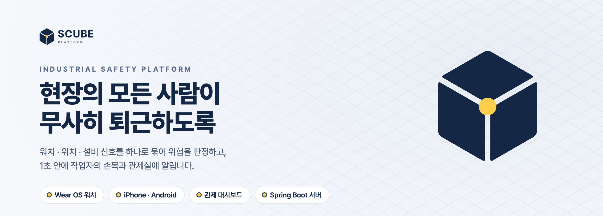
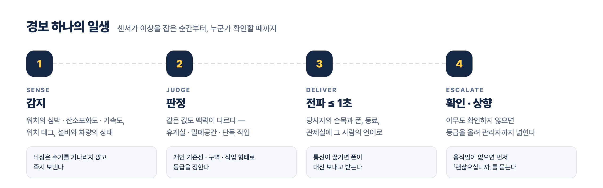
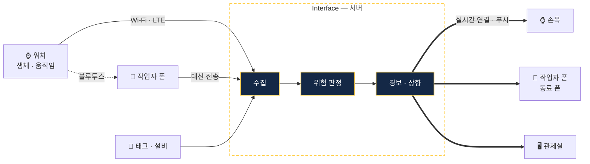
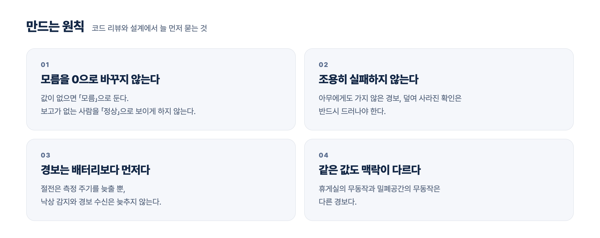

<picture>
  <source media="(prefers-color-scheme: dark)" srcset="assets/banner-dark.png">
  
</picture>

 

  
  
  
  
  
  

 

## Aegis

**SCUBE 위에서 도는 첫 제품, 산업현장 작업자 안전 통합 감시입니다.**

작업자가 찬 워치와 현장의 위치 태그 · 설비가 보내는 신호를 서버 한 곳에서 판정합니다. 위험하면 그 사람의 손목과 폰, 곁의 동료, 관제실에 동시에 알립니다. 아무도 확인하지 않으면 스스로 등급을 올려 관리자까지 넓힙니다.

 

<picture>
  <source media="(prefers-color-scheme: dark)" srcset="assets/flow-dark.png">
  
</picture>

 

## 무엇을 지키나

| | 위험 | 무엇으로 아는가 |
|:-:|---|---|
| 🚧 | **차량 · 중장비 충돌** | 사람과 차량의 거리, 부딪히기까지 남은 시간 |
| ⛔ | **위험구역 진입** | 구역 체류와 출입 자격. 경계에서 흔들리는 위치는 드나듦으로 세지 않는다 |
| ❤️ | **심박 · 산소포화도 이상** | 사람마다 배운 평소 심박과 비교한다. 일하는 중에는 상한(150회/분)만 본다 |
| 🤕 | **낙상 · 무동작** | 자유낙하와 충격 뒤의 정지. 움직임이 없으면 먼저 「괜찮으십니까」를 묻는다 |
| 🌡️ | **온열** | 체감온도와 심박의 오름세 |
| 📡 | **보고 두절 · 미착용** | 끊긴 신호와 착용 센서. 벗어 둔 워치는 알아서 감시를 멈췄다가 다시 차면 돌아온다 |
| 🆘 | **긴급 호출** | 작업자 폰에서 3초 누르기. 현장 동료와 관리자의 손목 · 폰에 바로 간다 |

 

## 구성

워치에 통신이 없으면 곁의 폰이 대신 보내고 받습니다. 경보는 받는 사람의 언어와 역할에 맞는 문장으로 나갑니다.

 

## 저장소

| | 저장소 | 무엇 | 기술 |
|:-:|---|---|---|
| 🛡️ | [**Interface**](https://github.com/Scube-Platform/Interface) | 서버 — 수집 · 위험 판정 · 경보 · 기기 게이트웨이 · 운영관리 | Java 21 · Spring Boot 4 · PostgreSQL |
| 🖥️ | [**Dashboard**](https://github.com/Scube-Platform/Dashboard) | 관제 대시보드 — 관제 · 생체 · 3D 현장 · 리포트 · 시스템 | React 19 · Vite · Tailwind CSS v4 |
| ⌚ | [**Watch**](https://github.com/Scube-Platform/Watch) | 워치 앱과 안드로이드 작업자 폰 앱 | Kotlin · Compose · Health Services |
| 📱 | [**iOS**](https://github.com/Scube-Platform/iOS) | 아이폰 작업자 앱 · 워치 블루투스 중계 | Swift · SwiftUI |
| 🌐 | [**Introduce**](https://github.com/Scube-Platform/Introduce) | 소개 사이트 — 경보 하나의 일생 · 밤의 공장 3D | Nuxt · three.js |
| 🎨 | [**Brand**](https://github.com/Scube-Platform/Brand) | Aegis · SCUBE 로고 원본 | SVG · PNG |

> [!NOTE]
> 저장소는 조직 구성원에게만 열려 있습니다.

 

## 목표

| 지표 | 목표 |
|---|:-:|
| 경보 전파 지연 — 발생에서 단말 발송까지 (P95) | **≤ 1.0초** |
| 수집 처리량 | **200 EPS** |
| 전파 성공률 — 수신확인 기준 | **99%** |
| 경고문 언어 — 지금 한국어 · English · Tiếng Việt · नेपाली | **3개 국어 이상** |
| 위험 판정 정확도 | **F1 0.90** |

 

<picture>
  <source media="(prefers-color-scheme: dark)" srcset="assets/principles-dark.png">
  
</picture>

 

  <picture>
    <source media="(prefers-color-scheme: dark)" srcset="assets/aegis-mark-reverse.svg">
    
  </picture>
  &nbsp;&nbsp;&nbsp;
  <picture>
    <source media="(prefers-color-scheme: dark)" srcset="assets/scube-mark-reverse.svg">
    
  </picture>

<b>Aegis</b>는 작업자를 지키는 방패, <b>SCUBE</b>는 단말 · 서버 · 관제가 한 꼭짓점에서 만나는 플랫폼입니다.

